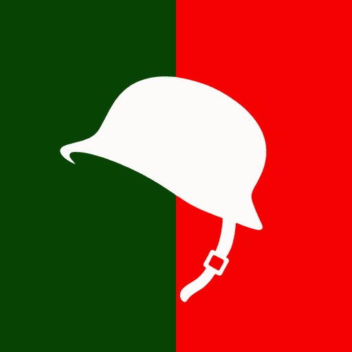

# DOD13-Client [](https://github.com/whamemer/dod13-client/actions) 
Reverse-engineered client library of **Day of Defeat 1.3** for [Xash3D FWGS](https://github.com/FWGS/xash3d-fwgs).

The code base is [hlsdk-portable](https://github.com/FWGS/hlsdk-portable) with the Day of Defeat client restored on top of it,
function by function, from the Steam version of the game. It replaces `client.dll` / `client.so` of the original game and works
with the original server library.

> **Status.** The client is playable and considered ready for testing. It is developed and tested on **Windows x86** with the
> latest developer build of Xash3D FWGS. Windows x64, Linux and Android are set up in the build files, but nobody has tested them
> yet. Bug reports are welcome.

## What is restored
* **Weapons.** All the weapons of the game with client-side prediction (bipods, sandbags, the mortar, scopes), weapon events,
  muzzle flashes, shells, tracers, surface hits, explosions, blood and corpses.
* **HUD.** Health and stamina, ammo, objective icons and capture progress, the map (small and large) with markers and
  grenades, crosshair, kill notices, chat, hint messages, spectator interface.
* **Effects.** The particle manager of the original game (built into the client), rain and snow, fog, muzzle smoke,
  rubble, static map props (`env_model`), particle shooters and the cinematic camera, all read from the entity lump of the map.
* **Movement and rendering.** Player movement shared with the server (prone, ladders, stamina jump), the model renderer with the
  poses of the bipod and the sandbag, view bob and recoil.
* **Menus.** Team and class menus, MOTD, scoreboard, spectator panel. The original uses VGUI2, which Xash3D does not have, so the
  panels are rebuilt on [freevgui](https://github.com/FWGS/freevgui) (VGUI1) from the layouts of the game (`resource/UI/*.res`).
* **Bug fixes of the original client**, optional and switchable at build time (see [Building](#building)).

## Download
Builds are published on the [Releases](https://github.com/whamemer/dod13-client/releases) page. Every push is also built by
GitHub Actions: the artifacts `dod13-client-<branch>-windows`, `...-windows_x64` and `...-linux` of a run contain the `dod` folder
that goes next to the engine.

## Installation
1. Get the [latest developer build of Xash3D FWGS](https://github.com/FWGS/xash3d-fwgs/releases/tag/continuous) and unpack it.
2. You have to own [Day of Defeat on Steam](https://store.steampowered.com/app/30/Day_of_Defeat/). Copy the `valve` and `dod`
   folders from your Steam installation into the Xash3D FWGS directory. The game files are not distributed with this project.
3. Unpack the build into the same directory, so that `client.dll` lands in `dod/cl_dlls/`.
4. Run `xash3d.exe -game dod`.

### Notes
* **The view does not tilt when strafing.** The tilt comes from the server cvar `sv_rollangle`. The default of GoldSrc is `2`, the
  default of Xash3D is `0`: put `sv_rollangle 2` and `sv_rollspeed 200` into the config of the server.
* **The weapon sways too much.** `cl_bob` is saved to `config.cfg`, and a value left by another client (Half-Life uses `0.01`)
  stays. The value of Day of Defeat is `0.005`.
* The menus look slightly different from the original, see the description of VGUI1 in [cl_dll/readme.md](cl_dll/readme.md).

## Documentation
Everything about the client is in [cl_dll/readme.md](cl_dll/readme.md):
* [Layout](cl_dll/readme.md#layout) of the source code;
* [Console variables](cl_dll/readme.md#console-variables) and [console commands](cl_dll/readme.md#console-commands-of-the-client)
  of the client, with defaults;
* [Build options](cl_dll/readme.md#build-options) and the [fixes of the bugs of the original game](cl_dll/readme.md#fixes-of-the-bugs-of-the-original-game);
* [How the engine talks to the client](cl_dll/readme.md#how-the-engine-talks-to-the-client) and the
  [user messages](cl_dll/readme.md#user-messages-and-console-commands);
* [Mechanics that exist only in Day of Defeat](cl_dll/readme.md#mechanics-that-exist-only-in-day-of-defeat) and
  [weapon prediction](cl_dll/readme.md#weapon-prediction);
* [VGUI1 instead of VGUI2](cl_dll/readme.md#vgui1-instead-of-vgui2) and the
  [differences from hlsdk-portable](cl_dll/readme.md#differences-from-hlsdk-portable).

## Building
Clone the source code with the submodules:
```
git clone https://github.com/whamemer/dod13-client --recursive
```
The build is 32-bit by default. The result is installed as `dod/cl_dlls/client.dll`. You need a
C and C++ compiler (MSVC, GCC or Clang) and either Python 3 (waf) or CMake 3.15 or newer.

### Options
`mod_options.txt` holds the options of the build, both build systems read it. `GAMEDIR` and `CLIENT_INSTALL_DIR` say where the
client is installed. Every fix of a bug of the original game has its own macro (`FOG_MINIMAP_FIX`, `SCOPE_WIDESCREEN_FIX`,
`MINIMAP_SPECTATOR_FIX`), all are `ON`. Set one to `OFF` to get the behavior of the original. They are described in
[cl_dll/readme.md](cl_dll/readme.md#fixes-of-the-bugs-of-the-original-game).

### waf
```
./waf configure
./waf build
./waf install --destdir=dist
```
On Windows use `waf.bat`. `-T debug` makes a debug build, `-8` allows a 64-bit build, `--disable-werror` turns off the strict
warnings of GCC and Clang.

### CMake
Windows x86:
```
cmake -A Win32 -S . -B build
cmake --build build --config Release
cmake --install build --config Release --prefix dist
```
Windows x64 (`-A x64 -D64BIT=ON`) and Linux (`cmake -S . -B build`) use the same commands. For Linux the CI builds in the
[Steam Runtime](https://github.com/ValveSoftware/steam-runtime) i386 environment, see
[.github/workflows/build.yml](.github/workflows/build.yml).

### Android
```
cd android
./gradlew assembleRelease
```
The Android project is included but not tested.

## Credits
* [FWGS](https://github.com/FWGS) for the engine, [Xash3D FWGS](https://github.com/FWGS/xash3d-fwgs), and for the SDK this code
  is based on, [hlsdk-portable](https://github.com/FWGS/hlsdk-portable).
* **Valve** for Day of Defeat.

## License
The code is based on the Half-Life SDK and is distributed under its license, see [LICENSE](LICENSE): it allows free,
non-commercial modifications of Valve games. Third-party parts keep their own licenses.

Day of Defeat and Half-Life are products of Valve Corporation. This project is not affiliated with or endorsed by Valve. It
contains no assets of the game, you need the original game to play.
